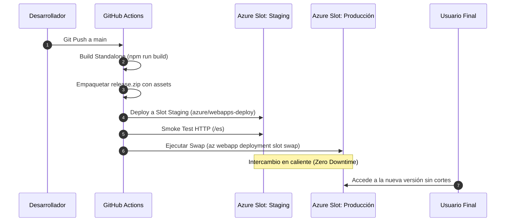

# Documento de Arquitectura y Diseño Técnico (HLD & LLD)
## Plataforma Web Corporativa — CSCloud Solutions (`cscloudsolutions.com.ar`)

---

**Empresa:** CSCloud Solutions  
**Propietario Técnico:** Manuel Chavez (`mchavez@cscloudsolutions.com.ar`)  
**Versión del Documento:** 1.0.0  
**Fecha:** 28 de Agosto de 2026  
**Ambiente:** Producción (PROD)  
**Estado:** Aprobado / Desplegado  

---

## Tabla de Contenidos
1. [Resumen Ejecutivo](#1-resumen-ejecutivo)
2. [High-Level Design (HLD)](#2-high-level-design-hld)
   - 2.1 [Visión General y Objetivos](#21-visión-general-y-objetivos)
   - 2.2 [Arquitectura Global del Sistema](#22-arquitectura-global-del-sistema)
   - 2.3 [Topología de Tráfico y Protección Edge](#23-topología-de-tráfico-y-protección-edge)
   - 2.4 [Matriz de Componentes y Responsabilidades](#24-matriz-de-componentes-y-responsabilidades)
3. [Low-Level Design (LLD)](#3-low-level-design-lld)
   - 3.1 [Arquitectura de la Aplicación (Frontend & Core)](#31-arquitectura-de-la-aplicación-frontend--core)
   - 3.2 [Infraestructura como Código (IaC - Terraform)](#32-infraestructura-como-código-iac---terraform)
   - 3.3 [Implementación de Seguridad Zero Trust](#33-implementación-de-seguridad-zero-trust)
   - 3.4 [Gestión de Secretos e Identidad Administrada](#34-gestión-de-secretos-e-identidad-administrada)
   - 3.5 [Autoescalado Horizontal y Métricas](#35-autoescalado-horizontal-y-métricas)
   - 3.6 [Auditoría, Diagnóstico y Observabilidad](#36-auditoría-diagnóstico-y-observabilidad)
   - 3.7 [Integraciones Externas y Envío de Formularios](#37-integraciones-externas-y-envío-de-formularios)
   - 3.8 [Pipeline de Integración y Despliegue Continuo (CI/CD)](#38-pipeline-de-integración-y-despliegue-continuo-cicd)
   - 3.9 [Configuración DNS y Certificados TLS](#39-configuración-dns-y-certificados-tls)
4. [Procedimientos Operativos y Runbooks](#4-procedimientos-operativos-y-runbooks)
5. [Glosario y Referencias](#5-glosario-y-referencias)

---

## 1. Resumen Ejecutivo

Este documento define la arquitectura técnica formal de la plataforma web corporativa de **CSCloud Solutions** (`cscloudsolutions.com.ar`), detallando el diseño de alto nivel (**HLD**) y bajo nivel (**LLD**). La plataforma ha sido migrada desde un entorno VPS tradicional hacia una arquitectura moderna, escalable y altamente segura sobre **Microsoft Azure** y **Cloudflare**, aprovisionada en su totalidad mediante **Infraestructura como Código (Terraform)** y operada mediante **GitHub Actions** bajo un esquema de despliegue continuo con cero tiempo de inactividad (*Zero-Downtime Blue/Green Swap*).

---

## 2. High-Level Design (HLD)

### 2.1 Visión General y Objetivos
- **Disponibilidad:** Garantizar un SLA de alta disponibilidad con autoescalado horizontal reactivo ante picos de demanda.
- **Seguridad Zero Trust:** Aislar completamente el origen en Azure, permitiendo tráfico web únicamente a través de la red perimetral de Cloudflare (WAF/DDoS Protection) y gestionando secretos mediante identidades administradas con Azure RBAC.
- **Despliegues sin Downtime:** Uso de *Deployment Slots* (Staging y Producción) para validar versiones y conmutar el tráfico instantáneamente.
- **Internacionalización y Rendimiento:** Motor Next.js 15 SSR con soporte multilingüe nativo (Español, Inglés y Portugués) y modo de compilación optimizado *Standalone*.

### 2.2 Arquitectura Global del Sistema

```
+-----------------------------------------------------------------------------------+
|                                 USUARIO FINAL / NAVEGADOR                         |
+-----------------------------------------------------------------------------------+
                                         |  HTTPS (TLS 1.3)
                                         v
+-----------------------------------------------------------------------------------+
|                        CLOUDFLARE EDGE NETWORK (CDN / WAF / DNS)                  |
|  - Dominio: cscloudsolutions.com.ar                                               |
|  - Mitigación DDoS / Web Application Firewall                                     |
|  - Caching de assets estáticos (_next/static, imágenes)                           |
|  - Certificado SSL Universal (Edge SSL)                                           |
+-----------------------------------------------------------------------------------+
                                         |  HTTPS Cifrado (TLS 1.2+)
                                         |  [Whitelisting de IPs Cloudflare]
                                         v
+-----------------------------------------------------------------------------------+
|                  MICROSOFT AZURE (Región: West US 2 - Resource Group)             |
|                                                                                   |
|  +-----------------------------------------------------------------------------+  |
|  |              AZURE LINUX WEB APP (cscloudsolutions.azurewebsites.net)       |  |
|  |  - Plan de Servicio: cscs-asp-wus2-prod (SKU P0v3: 1 vCPU, 4GB RAM, SSD)    |  |
|  |  - Runtime: Node.js 22 LTS (Next.js 15 Standalone: node server.js)         |  |
|  |                                                                             |  |
|  |    +-----------------------------+     +-----------------------------+      |  |
|  |    |     SLOT: PRODUCCIÓN        | <==>|        SLOT: STAGING        |      |  |
|  |    |  (cscloudsolutions.com.ar)  | Swap| (cscloudsolutions-staging) |      |  |
|  |    +-----------------------------+     +-----------------------------+      |  |
|  +-----------------------------------------------------------------------------+  |
|                                         |                                         |
|                 +-----------------------+-----------------------+                 |
|                 |                                               |                 |
|                 v                                               v                 |
|  +-----------------------------+                 +-----------------------------+  |
|  |      AZURE KEY VAULT        |                 |   LOG ANALYTICS WORKSPACE   |  |
|  |    (cscs-kv-wus2-prod)      |                 |    (cscs-law-wus2-prod)     |  |
|  |  - Cifrado de Secretos      |                 |  - HTTP Logs / Audit Logs   |  |
|  |  - Azure RBAC (Identity)    |                 |  - Métricas de Plataforma   |  |
|  +-----------------------------+                 +-----------------------------+  |
+-----------------------------------------------------------------------------------+
```

### 2.3 Topología de Tráfico y Protección Edge
1. El usuario consulta `cscloudsolutions.com.ar`.
2. Cloudflare resuelve la petición vía Anycast DNS, inspecciona amenazas perimetrales (WAF/DDoS), sirve contenido estático en caché y reenvía las solicitudes dinámicas al origen de Azure.
3. El App Service de Azure valida que la IP de origen pertenezca a la lista blanca oficial de Cloudflare; cualquier intento de acceso directo a la IP de Azure o al hostname `azurewebsites.net` por fuera de Cloudflare es rechazado (`HTTP 403 Forbidden`).
4. La aplicación ejecuta el renderizado en Node.js 22 y responde a Cloudflare, quien entrega el contenido comprimido y cifrado al usuario.

### 2.4 Matriz de Componentes y Responsabilidades

| Componente | Tecnología / Servicio | Responsabilidad |
|---|---|---|
| **DNS & Edge CDN** | Cloudflare | Gestión de DNS, Proxy Anycast, SSL público y mitigación DDoS |
| **Cómputo Web** | Azure Linux Web App | Ejecución de Next.js 15 en contenedor standalone optimizado |
| **Plan de Cómputo** | Azure App Service Plan (`P0v3`) | Asignación de recursos (1 vCPU, 4GB RAM) y base para slots |
| **Escalabilidad** | Azure Monitor Autoscale | Escalado elástico de 1 a 3 instancias por métricas de CPU/RAM |
| **Gestión de Secretos**| Azure Key Vault (`cscs-kv-wus2-prod`) | Custodia segura de credenciales con RBAC |
| **Observabilidad** | Log Analytics Workspace (`cscs-law`) | Auditoría centralizada de peticiones HTTP, plataforma y eventos |
| **Automatización CI/CD**| GitHub Actions | Compilación de código, empaquetado standalone y swap de slots |

---

## 3. Low-Level Design (LLD)

### 3.1 Arquitectura de la Aplicación (Frontend & Core)
- **Framework:** Next.js 15.5+ con React 19 y TypeScript 5.8+.
- **Modo de Compilación:** `output: 'standalone'` en `next.config.mjs`.
  - La compilación genera un servidor Node.js independiente y autocontenido (`.next/standalone/server.js`), eliminando la necesidad de empaquetar carpetas completas de `node_modules` (>300MB) y reduciendo el artefacto a menos de 18MB.
- **Internacionalización (i18n):** `next-intl` con enrutamiento prefijado (`/es`, `/en`, `/pt-BR`).
- **Seguridad HTTP:** Configuración de cabeceras estrictas en Next.js:
  - `Content-Security-Policy` (CSP)
  - `Strict-Transport-Security` (HSTS: 2 años con subdominios y preload)
  - `X-Frame-Options: SAMEORIGIN`
  - `X-Content-Type-Options: nosniff`
  - `Referrer-Policy: strict-origin-when-cross-origin`

### 3.2 Infraestructura como Código (IaC - Terraform)
Todos los recursos de infraestructura se gestionan mediante el proveedor oficial `hashicorp/azurerm` (v4.81+) en `infra/terraform/`.

#### Estándares de Nomenclatura Aplicados
- **Prefijo Corporativo:** `cscs`
- **Región:** `westus2` (identificador corto en nombres: `wus2`)
- **Ambiente:** `prod` (código) / `PROD` (etiquetas)
- **Estructura Estándar:** `cscs-<tipo_recurso>-<zona>-<ambiente>`

| Recurso Azure | Identificador en Terraform | Nombre Asignado |
|---|---|---|
| Resource Group | `azurerm_resource_group.cscs_rg` | `cscs-webpage-wus2-prod` |
| App Service Plan | `azurerm_service_plan.cscs_asp` | `cscs-asp-wus2-prod` |
| Autoscale Setting | `azurerm_monitor_autoscale_setting.cscs_autoscale` | `cscs-autoscale-wus2-prod` |
| Linux Web App (Prod)| `azurerm_linux_web_app.cscs_app` | `cscloudsolutions` |
| Web App Slot (Staging)| `azurerm_linux_web_app_slot.cscs_app_staging`| `staging` |
| Key Vault | `azurerm_key_vault.cscs_kv` | `cscs-kv-wus2-prod` |
| Log Analytics Workspace| `azurerm_log_analytics_workspace.cscs_law` | `cscs-law-wus2-prod` |

#### Etiquetas Obligatorias (Resource Tagging)
```hcl
tags = {
  CostCenter  = "WebPage"
  Environment = "PROD"
  ManagedBy   = "Terraform"
  Owner       = "mchavez@cscloudsolutions.com.ar"
  Product     = "WebPage"
  Service     = "WebPage"
  Department  = "IT"
  Role        = "WebPage"
}
```

### 3.3 Implementación de Seguridad Zero Trust
1. **Regla Ingress por Defecto:** `ip_restriction_default_action = "Deny"`.
2. **Lista Blanca de Cloudflare:** Se inyectan dinámicamente las 22 subredes oficiales de Cloudflare (IPv4: `/20`, `/22`, `/18`, `/15`, `/13` e IPv6: `/32`, `/29`).
3. **Hardening de Protocolos:**
   - `ftps_state = "Disabled"`
   - `ftp_publish_basic_authentication_enabled = false`
   - `webdeploy_publish_basic_authentication_enabled = false`
   - `https_only = true`
   - `minimum_tls_version = "1.2"`

### 3.4 Gestión de Secretos e Identidad Administrada
- **Azure Key Vault:** Creado con `rbac_authorization_enabled = true`.
- **Identidad Administrada:** Las instancias de App Service (`cscloudsolutions` y slot `staging`) poseen identidades `SystemAssigned`.
- **Asignación de Roles RBAC:**
  - Rol: `Key Vault Secrets User` (ID: `4633458b-17de-408a-b874-0445c86b69e6`).
  - Asignado a: Principal ID de Producción (`5cc65150-...`) y Staging (`91a2acf6-...`).

### 3.5 Autoescalado Horizontal y Métricas
- **Capacidad:** Mínimo `1`, Máximo `3`, Por defecto `1`.
- **Scale Out (CPU):** Si CPU promedio > 70% durante 5 min $\rightarrow$ +1 instancia (cooldown 5 min).
- **Scale Out (RAM):** Si Memoria promedio > 80% durante 5 min $\rightarrow$ +1 instancia (cooldown 5 min).
- **Scale In (CPU):** Si CPU promedio < 25% durante 5 min $\rightarrow$ -1 instancia (cooldown 5 min) para optimizar costos.

### 3.6 Auditoría, Diagnóstico y Observabilidad
- **Log Analytics Workspace:** `cscs-law-wus2-prod` con retención de 30 días.
- **Diagnostic Settings (`cscs-diag-app-wus2-prod` y `cscs-diag-kv-wus2-prod`):**
  - Logs enviados: `AppServiceHTTPLogs`, `AppServiceAppLogs`, `AppServiceAuditLogs`, `AppServiceConsoleLogs`, `AuditEvent` (Key Vault).
  - Métricas enviadas: `AllMetrics`.

### 3.7 Integraciones Externas y Envío de Formularios
- **Google reCAPTCHA v3:** Validación en backend de tokens anti-bot (`NEXT_PUBLIC_RECAPTCHA_SITE_KEY` y `RECAPTCHA_SECRET_KEY`).
- **Microsoft Graph API:** Envío transaccional de correos de contacto vía OAuth 2.0 Client Credentials (`AZURE_TENANT_ID`, `AZURE_CLIENT_ID`, `AZURE_CLIENT_SECRET`).
- **Sentry Monitoring:** Telemetría de errores en tiempo real y rastreo de excepciones en frontend y backend.

### 3.8 Pipeline de Integración y Despliegue Continuo (CI/CD)
El flujo en `.github/workflows/deploy.yml` implementa el siguiente ciclo:



### 3.9 Configuración DNS y Certificados TLS
Configuración establecida en Cloudflare DNS:

| Tipo | Nombre | Destino / Valor | Proxy Status |
|---|---|---|---|
| **TXT** | `asuid` | `BB199346506019711C06F8B6D23E333D5151A8E27418FA5C7897ED7128AD3E66` | DNS Only (Gris) |
| **CNAME** | `@` | `cscloudsolutions.azurewebsites.net` | Proxied (Naranja) |
| **CNAME** | `www` | `cscloudsolutions.azurewebsites.net` | Proxied (Naranja) |

---

## 4. Procedimientos Operativos y Runbooks

### Despliegue Manual de Emergencia
```bash
# 1. Compilar y empaquetar standalone
npm run build
cp -r public .next/standalone/public
cp -r .next/static .next/standalone/.next/static
cd .next/standalone && zip -r ../../release.zip . && cd ../..

# 2. Desplegar a Staging
az webapp deploy --resource-group cscs-webpage-wus2-prod --name cscloudsolutions --slot staging --src-path release.zip --type zip

# 3. Swap a Producción
az webapp deployment slot swap --resource-group cscs-webpage-wus2-prod --name cscloudsolutions --slot staging --target-slot production
```

### Escalado Vertical de Emergencia (Scale Up)
Para modificar el plan de `P0v3` a `P1v3`:
```bash
az appservice plan update --name cscs-asp-wus2-prod --resource-group cscs-webpage-wus2-prod --sku P1v3
```

---

## 5. Glosario y Referencias
- **HLD:** High-Level Design (Diseño de Alto Nivel).
- **LLD:** Low-Level Design (Diseño de Bajo Nivel).
- **Zero Trust:** Modelo de seguridad basado en verificar explícitamente, otorgar mínimo privilegio y asumir brechas.
- **Standalone:** Modo de compilación de Next.js que incluye solo las dependencias necesarias de producción.
- **Swap:** Conmutación atómica de tráfico entre dos slots de Azure App Service sin reiniciar procesos en frío.
