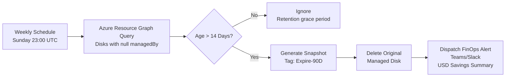

## Table of Contents

1. [The Silent Trap of Orphan Storage](#1-the-silent-trap)
2. [Financial Breakdown: The Real Cost](#2-financial-breakdown)
3. [Enterprise-Scale Detection with Azure Resource Graph](#3-enterprise-scale-detection)
4. [Automating Inventory with Azure CLI and PowerShell](#4-automating-inventory)
5. [Defensive Remediation: Snapshot First Protocol](#5-defensive-remediation)
6. [Proactive Governance Using Azure Policy](#6-proactive-governance)
7. [Continuous Cost Optimization Pipeline](#7-continuous-pipeline)

---

## 1. The Silent Trap of Orphan Storage in Microsoft Azure

In day-to-day operations of enterprise Microsoft Azure environments, engineering and cloud operations teams continuously deploy, scale, and decommission dozens of virtual machines. Whether running integration tests, temporary workloads, pre-production validation, or database migrations, compute lifecycle management is exceptionally dynamic.

However, an **architectural and financial trap** often goes unnoticed by administrators and engineering leads: **asymmetric storage decoupling**.

When an engineer or CI/CD pipeline deletes an Azure Virtual Machine via the Azure Portal, Azure CLI, or Terraform without explicitly configuring cascade deletion, Azure deletes only the compute layer (allocated CPU cores and memory). **The underlying Azure Managed Disks remain untouched within the Resource Group.**

To Azure's control plane, these disks are fully provisioned storage volumes with:
- High availability
- Regional or local redundancy (LRS, ZRS, GRS)
- Reserved throughput and IOPS

**Consequence:** Microsoft continues to bill for every provisioned gigabyte, whether an active virtual machine is running I/O operations or it has sat completely unattached for six months.

In enterprise and mid-market environments lacking automated cloud governance, these **orphan disks (unattached disks)** typically account for **12% to 35% of total monthly storage spend**, consuming operational budgets without driving business value.

**Keywords:** Azure Managed Disks, orphan disks, unattached disks, Azure cost optimization, storage at rest.

---

## 2. Financial Breakdown: The Real Cost of an Orphan Disk

Unlike compute instances, where hourly charges stop immediately once a machine enters the `Deallocated` state, **managed disks are billed on total provisioned capacity, not used capacity**.

If you provision a 1 TB Premium SSD (P30) with only 20 GB written, you are billed every month for the **full 1024 GB**.

### Baseline Pricing Structure (Standard Regions)

| Disk Tier | Typical Size / SKU | Capacity | Base IOPS | Monthly Cost/Disk (USD) | Annual Cost 10 Disks (USD) |
|---|---|---|---|---|---|
| **Standard HDD** | S20 / S30 | 512 GB - 1 TB | 500 | $20 - $40 | $2,400 - $4,800 |
| **Standard SSD** | E20 / E30 | 512 GB - 1 TB | 2,000 | $38 - $75 | $4,560 - $9,000 |
| **Premium SSD (P30)** | P30 | 1,024 GB (1 TB) | 5,000 | $135 - $155 | $16,200 - $18,600 |
| **Premium SSD v2** | Provisioned | 1 TB + 6,000 IOPS | 6,000 | $160 - $210 | $19,200 - $25,200 |
| **Ultra Disk** | Provisioned | 1 TB + 10,000 IOPS | 10,000 | $300 - $480 | $36,000 - $57,600 |

In an engineering organization with 15 engineers deploying services across multiple environments, finding between 20 and 50 unattached disks is common. This represents an annual leak of **$30,000 to $80,000 USD**, spent on storage volumes generating zero reads and zero writes.

**Keywords:** Azure storage costs, Premium SSD, cloud cost optimization, FinOps, cost management.

---

## 3. Enterprise-Scale Detection Using Azure Resource Graph (ARG) and KQL

Manually clicking through individual subscriptions and resource groups in the Azure Portal is inefficient when managing dozens of subscriptions organized under complex Management Group hierarchies. The standard tool for tenant-wide, millisecond audits is **Azure Resource Graph** paired with **Kusto Query Language (KQL)**, enabling concurrent queries across hundreds of subscriptions.

### Query 1: Complete Orphan Disk Inventory with Metadata

```kusto
// KQL Query for Azure Resource Graph Explorer
resources
| where type =~ 'microsoft.compute/disks'
| where isnull(managedBy) or managedBy == ""
| project 
    subscriptionId,
    resourceGroup,
    diskName = name,
    skuName = sku.name,
    skuTier = sku.tier,
    diskSizeGB = properties.diskSizeGB,
    timeCreated = properties.timeCreated,
    osType = properties.osType,
    location = location,
    tags = tags
| order by diskSizeGB desc
```

### Query 2: Aggregated Waste Analysis per Subscription

```kusto
resources
| where type =~ 'microsoft.compute/disks'
| where isnull(managedBy) or managedBy == ""
| summarize 
    UnattachedDisksCount = count(),
    TotalWasteGB = sum(toint(properties.diskSizeGB))
    by subscriptionId, tostring(sku.name)
| order by TotalWasteGB desc
```

**Keywords:** Azure Resource Graph, KQL queries, cloud infrastructure audit, Azure CLI, cloud governance.

---

## 4. Automating Inventory with Azure CLI and PowerShell

### Azure CLI Script: Exporting Audit Data to JSON/CSV

```bash
#!/usr/bin/env bash
# Audit script to identify unattached disks across all accessible subscriptions
set -euo pipefail

echo "======================================================================"
echo " CSCloudSolutions - Unattached Managed Disk Audit on Microsoft Azure"
echo "======================================================================"

QUERY="resources | where type =~ 'microsoft.compute/disks' | where isnull(managedBy) or managedBy == '' | project subscriptionId, resourceGroup, name, sku.name, properties.diskSizeGB, properties.timeCreated | order by properties.diskSizeGB desc"

echo "[*] Querying Azure Resource Graph across all subscriptions..."
az graph query -q "$QUERY" --first 1000 --output table

# Export to JSON for FinOps analysis
az graph query -q "$QUERY" --first 1000 --output json > ./unattached_disks_report.json
echo "[+] Audit report exported successfully to unattached_disks_report.json"
```

### PowerShell Script: Age-Based Filtering

A disk unattached for fewer than 24 hours might be part of ongoing maintenance. **However, an unattached disk untouched for 7 or more days is almost certainly abandoned:**

```powershell
<#
.SYNOPSIS
Identifies orphan disks older than 7 days in the current subscription context.
#>

$SevenDaysAgo = (Get-Date).AddDays(-7)

$UnattachedDisks = Get-AzDisk | Where-Object { 
    $null -eq $_.ManagedBy -and $_.TimeCreated -lt $SevenDaysAgo 
}

Write-Host "Orphan disks older than 7 days found: $($UnattachedDisks.Count)" -ForegroundColor Yellow

$UnattachedDisks | Select-Object Name, ResourceGroupName, Sku, DiskSizeGB, TimeCreated | Format-Table -AutoSize
```

**Keywords:** Azure automation, PowerShell Azure, infrastructure as code, DevOps, CI/CD pipeline.

---

## 5. Defensive Remediation: Snapshot First, Delete Later Protocol

The primary hesitation when automating disk cleanups is the risk of permanently removing a disk holding critical data. To mitigate operational risk while maintaining regulatory compliance (ISO 27001, SOC 2, HIPAA), we enforce a strict **"Snapshot First, Delete Later"** methodology.

### Why Convert an Orphan Disk to a Snapshot?

1. **Dramatic Cost Reduction:**
   - Premium SSD (1 TB): ~$140 USD/month
   - Snapshot (40 GB actual compressed): ~$2.00 USD/month
   - **Immediate savings: 98.5%**

2. **Fast Recovery:** A snapshot reconstituted into a Managed Disk in under 90 seconds

3. **Immutability and Encryption:** Preserves original encryption and metadata

### Safe Remediation Script (PowerShell)

```powershell
param (
    [Parameter(Mandatory=$true)]
    [string]$ResourceGroupName,
    [Parameter(Mandatory=$true)]
    [string]$DiskName
)

$Disk = Get-AzDisk -ResourceGroupName $ResourceGroupName -DiskName $DiskName

if ($null -ne $Disk.ManagedBy) {
    Write-Error "Disk $DiskName is currently attached to a virtual machine. Operation aborted for safety."
    exit 1
}

Write-Host "[1/3] Creating safety snapshot for $DiskName..." -ForegroundColor Cyan
$SnapshotConfig = New-AzSnapshotConfig -SourceResourceId $Disk.Id -Location $Disk.Location -CreateOption Copy
$SnapshotName = "$($DiskName)-predelete-snapshot-$(Get-Date -Format 'yyyyMMdd')"
$Snapshot = New-AzSnapshot -ResourceGroupName $ResourceGroupName -SnapshotName $SnapshotName -Snapshot $SnapshotConfig

Write-Host "[2/3] Snapshot created successfully: $($Snapshot.Name)" -ForegroundColor Green

Write-Host "[3/3] Deleting target unattached Managed Disk..." -ForegroundColor Yellow
Remove-AzDisk -ResourceGroupName $ResourceGroupName -DiskName $DiskName -Force

Write-Host "[+] Remediation completed. Disk removed and archived to low-cost snapshot." -ForegroundColor Green
```

**Keywords:** Azure snapshots, cloud backup, disaster recovery, regulatory compliance.

---

## 6. Proactive Governance Using Azure Policy

Running manual scripts or one-off cleanups is inherently reactive. True cloud operational maturity, as outlined by the **FinOps Foundation**, focuses on **eliminating resource leakage at the source**.

### 1. Native Cascade Deletion in VM Templates

When provisioning virtual machines using Bicep, ARM templates, or Terraform, set `deleteOption: 'Delete'`:

```bicep
// Bicep sample for VM deployment with automatic disk cleanup
resource vm 'Microsoft.Compute/virtualMachines@2023-09-01' = {
  name: 'vm-app-production'
  location: location
  properties: {
    storageProfile: {
      osDisk: {
        createOption: 'FromImage'
        managedDisk: {
          storageAccountType: 'Premium_LRS'
        }
        deleteOption: 'Delete' // <--- Deletes OS Disk automatically on VM termination
      }
      dataDisks: [
        {
          lun: 0
          createOption: 'Empty'
          diskSizeGB: 256
          deleteOption: 'Delete' // <--- Deletes Data Disk automatically
        }
      ]
    }
  }
}
```

### 2. Azure Policy: Mandatory Lifecycle Tagging

Deploy an Azure Policy definition with `AuditIfNotExists` rule that detects unattached disks and enforces a lifecycle tracking tag like `LifecycleStatus: Orphan-Review`.

**Keywords:** Azure Policy, infrastructure as code, Bicep, Terraform, cloud governance.

---

## 7. Continuous Cost Optimization Pipeline Architecture

For enterprise teams supporting dozens of environments, automate remediation end-to-end using an **Azure Logic App** or **Azure Automation Runbook** scheduled during non-business hours:



This automated pipeline requires zero manual intervention, prevents accidental data loss, and delivers measurable ROI metrics directly to cloud infrastructure leaders and financial stakeholders.

**Keywords:** Azure Logic Apps, process automation, FinOps automation, cloud cost management.

---

## 8. Summary and Recommended Actions

Cost optimization in Azure does not require scaling down production systems or reducing workload performance. It requires **eliminating hidden waste**.

Unattached disks are one of the most common causes of silent cloud cost inflation. Typically representing **$30,000-$80,000 USD annually** in mid-market organizations.

### Action Plan:

1. **Run the provided KQL queries** to audit your tenant immediately
2. **Implement cascade deletion** (deleteOption: 'Delete') in all new VM templates
3. **Configure Snapshot First protocol** for detected orphan disks
4. **Automate the process** with Azure Logic Apps or Automation Runbooks
5. **Monitor continuously** with Azure Policy and lifecycle tags

**Keywords:** cloud cost optimization, FinOps best practices, Azure cost management, cloud architecture patterns.

---

## Primary Keywords (SEO-Optimized)

`Azure Managed Disks` | `Orphan Disks` | `Unattached Disks` | `FinOps` | `Azure Resource Graph` | `KQL Queries` | `Azure CLI` | `PowerShell Azure` | `Azure Cost Optimization` | `Cloud Governance` | `Azure Policy` | `Snapshot Strategy` | `Azure Cost Management` | `Infrastructure as Code` | `Microsoft Azure` | `Cloud Architecture` | `Storage Optimization`

---

## 🚀 Ready to Optimize Your Azure Infrastructure?

**CSCloudSolutions** specializes in cloud cost audits, FinOps implementation, and enterprise infrastructure automation.

If your organization:
- ✅ Manages multiple Azure subscriptions
- ✅ Suspects waste in storage, networking, or compute
- ✅ Wants to implement automated cloud governance
- ✅ Seeks to reduce expenses without compromising performance

**📞 Schedule a Free Diagnostic Session with Our Certified Azure Architects**

We offer:
- Free 90-minute audit of your Azure tenant
- Detailed cost optimization opportunities report
- Custom FinOps implementation roadmap
- Ongoing cost optimization support

🔧 Discover **CSCloud FinOps** at [finops.cscloudsolutions.com.ar](https://finops.cscloudsolutions.com.ar)

**👉 [Contact: sales@cscloudsolutions.com.ar](mailto:sales@cscloudsolutions.com.ar) | [Schedule consultation](https://cscloudsolutions.com.ar/#contacto)**

Connect with us:
- 💼 [@Manuel Chavez](https://linkedin.com/in/manuel-enrique-chavez-manzano/)
- 💼 [CSCloudSolutions](https://www.linkedin.com/company/cscloudsolutions)
- 🌐 [cscloudsolutions.com.ar](https://cscloudsolutions.com.ar)

---

*Published by Manuel Chavez | Certified Azure Architect | CSCloudSolutions*
