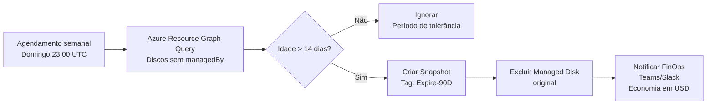

# Como Detectar e Remover Discos Não Associados no Azure e Recortar Custos de Armazenamento

**Por Manuel Chavez** | *Arquiteto Azure & Líder de Infraestrutura Cloud na CSCloudSolutions*

---

## Índice
1. [A Armadilha Silenciosa do Armazenamento Órfão](#1-a-armadilha-silenciosa)
2. [Anatomia Financeira: Quanto Custa](#2-anatomia-financeira)
3. [Detecção em Escala com Azure Resource Graph](#3-detecção-em-escala)
4. [Automação com Azure CLI e PowerShell](#4-automação-do-inventário)
5. [Protocolo Defensivo: Snapshots](#5-protocolo-defensivo)
6. [Governança Proativa com Azure Policy](#6-governança-proativa)
7. [Pipeline Automatizado de Redução de Custos](#7-automação-contínua)

---

## 1. A Armadilha Silenciosa do Armazenamento Órfão no Microsoft Azure

Na gestão diária de ambientes corporativos no Microsoft Azure, as equipes de operações e engenharia criam, escalam e destroem dezenas de máquinas virtuais (Azure Virtual Machines) continuamente. Seja para testes de integração, implantações temporárias, ambientes de pré-produção ou migrações de bancos de dados, o ciclo de vida da infraestrutura de computação é cada vez mais dinâmico.

No entanto, existe uma **armadilha arquitetural e financeira** que costuma passar despercebida: a **desvinculação assimétrica do armazenamento**. 

Quando um engenheiro ou pipeline de CI/CD remove uma máquina virtual pelo Azure Portal, Azure CLI ou Terraform sem configuração explícita de exclusão em cascata, Azure remove apenas a camada de computação (CPU e memória RAM alocadas), mas **os discos gerenciados (Azure Managed Disks) permanecem intactos** no Resource Group.

Para a plataforma Azure, esses discos continuam sendo volumes provisionados com:
- Alta disponibilidade
- Redundância geográfica ou local (LRS, ZRS, GRS)
- Desempenho reservado (IOPS e Throughput)

**Consequência:** Microsoft continua faturando cada gigabyte provisionado, independentemente de o disco estar conectado a uma VM ou abandonado há meses.

Em ambientes corporativos sem políticas automatizadas de governança, esses **discos órfãos (unattached disks)** podem representar entre **12% a 35% do gasto mensal total com armazenamento**, drenando orçamento operacional sem gerar valor de negócio.

**Palavras-chave:** Azure Managed Disks, discos órfãos, unattached disks, otimização de custos Azure, armazenamento em repouso.

---

## 2. Anatomia Financeira: Quanto Custa Realmente um Disco Órfão?

Diferentemente das máquinas virtuais, onde o custo cessa ao estado `Deallocated`, **os discos gerenciados cobram pela capacidade total aprovisionada, não pelo espaço consumido**.

Se você provisionar um disco Premium SSD de 1 TB (P30) com apenas 20 GB gravados, pagará mensalmente pelos **1024 GB completos**.

### Estrutura de Preços Média (Regiões Padrão)

| Nível de Disco | Tamanho / SKU | Capacidade | IOPS Base | Custo Mensal/Disco (USD) | Custo Anual 10 Discos (USD) |
|---|---|---|---|---|---|
| **Standard HDD** | S20 / S30 | 512 GB - 1 TB | 500 | $20 - $40 | $2,400 - $4,800 |
| **Standard SSD** | E20 / E30 | 512 GB - 1 TB | 2,000 | $38 - $75 | $4,560 - $9,000 |
| **Premium SSD (P30)** | P30 | 1,024 GB (1 TB) | 5,000 | $135 - $155 | $16,200 - $18,600 |
| **Premium SSD v2** | Provisionado | 1 TB + 6,000 IOPS | 6,000 | $160 - $210 | $19,200 - $25,200 |
| **Ultra Disk** | Provisionado | 1 TB + 10,000 IOPS | 10,000 | $300 - $480 | $36,000 - $57,600 |

Em uma infraestrutura típica com 15 desenvolvedores e múltiplos microsserviços, encontrar entre 20 e 50 discos desasociados é comum. Isso representa uma **perda silenciosa entre $30.000 e $80.000 USD anuais**, atribuível exclusivamente a discos sem leitura ou escrita.

**Palavras-chave:** custo de armazenamento Azure, Premium SSD, otimização de custos em nuvem, FinOps.

---

## 3. Detecção em Escala Corporativa com Azure Resource Graph (ARG) e KQL

O método tradicional (revisar assinatura por assinatura no Portal) não é escalável com dezenas de assinaturas. A ferramenta definitiva é o **Azure Resource Graph** com **Kusto Query Language (KQL)**, permitindo auditar centenas de assinaturas simultaneamente em milissegundos.

### Query 1: Inventário Completo de Discos Órfãos

```kusto
// Consulta KQL no Azure Resource Graph Explorer
resources
| where type =~ 'microsoft.compute/disks'
| where isnull(managedBy) or managedBy == ""
| project 
    subscriptionId,
    resourceGroup,
    diskName = name,
    skuName = sku.name,
    skuTier = sku.tier,
    diskSizeGB = properties.diskSizeGB,
    timeCreated = properties.timeCreated,
    osType = properties.osType,
    location = location,
    tags = tags
| order by diskSizeGB desc
```

### Query 2: Cálculo Agregado de Desperdício por Assinatura

```kusto
resources
| where type =~ 'microsoft.compute/disks'
| where isnull(managedBy) or managedBy == ""
| summarize 
    UnattachedDisksCount = count(),
    TotalWasteGB = sum(toint(properties.diskSizeGB))
    by subscriptionId, tostring(sku.name)
| order by TotalWasteGB desc
```

**Palavras-chave:** Azure Resource Graph, KQL queries, auditoría de infraestrutura, Azure CLI, governança em nuvem.

---

## 4. Automação do Inventário com Azure CLI e PowerShell

### Script em Azure CLI: Exportação de Auditoria para JSON/CSV

```bash
#!/usr/bin/env bash
# Script de auditoria para identificar discos não associados em todas as assinaturas
set -euo pipefail

echo "======================================================================"
echo " CSCloudSolutions - Auditoria de Discos Desasociados no Microsoft Azure"
echo "======================================================================"

QUERY="resources | where type =~ 'microsoft.compute/disks' | where isnull(managedBy) or managedBy == '' | project subscriptionId, resourceGroup, name, sku.name, properties.diskSizeGB, properties.timeCreated | order by properties.diskSizeGB desc"

echo "[*] Consultando Azure Resource Graph em todas as assinaturas..."
az graph query -q "$QUERY" --first 1000 --output table

# Exportar para JSON para análise FinOps
az graph query -q "$QUERY" --first 1000 --output json > ./unattached_disks_report.json
echo "[+] Relatório salvo com sucesso em unattached_disks_report.json"
```

### Script em PowerShell: Classificação por Tempo de Inatividade

Um disco desasociado há menos de 24h pode ser manutenção programada. **Porém, um disco órfão com mais de 7 dias é abandonado com 99% de certeza:**

```powershell
<#
.SYNOPSIS
Identifica discos órfãos com mais de 7 dias de criação na assinatura ativa.
#>

$SevenDaysAgo = (Get-Date).AddDays(-7)

$UnattachedDisks = Get-AzDisk | Where-Object { 
    $null -eq $_.ManagedBy -and $_.TimeCreated -lt $SevenDaysAgo 
}

Write-Host "Discos órfãos com mais de 7 dias encontrados: $($UnattachedDisks.Count)" -ForegroundColor Yellow

$UnattachedDisks | Select-Object Name, ResourceGroupName, Sku, DiskSizeGB, TimeCreated | Format-Table -AutoSize
```

**Palavras-chave:** automação Azure, PowerShell Azure, infraestrutura como código, DevOps, CI/CD pipeline.

---

## 5. O Protocolo Defensivo: Snapshot Preventivo Antes da Exclusão

O maior receio ao aplicar políticas de redução de custos é excluir acidentalmente um disco contendo dados críticos. Para eliminar o risco operacional e garantir conformidade regulatória (ISO 27001, SOC 2, HIPAA), aplicamos a regra: **"Snapshot First, Delete Later"**.

### Por que converter um disco órfão em Snapshot?

1. **Diferença Expressiva de Custo:**
   - Disco Premium SSD (1 TB): ~$140 USD/mês
   - Snapshot (40 GB reais comprimidos): ~$2,00 USD/mês
   - **Economia imediata: 98,5%**

2. **Capacidade de Restauração Rápida:** Um snapshot reconvertido em Managed Disk em menos de 90 segundos

3. **Imutabilidade e Criptografia:** Preserva metadados e criptografia original

### Script de Remediação Segura (PowerShell)

```powershell
param (
    [Parameter(Mandatory=$true)]
    [string]$ResourceGroupName,
    [Parameter(Mandatory=$true)]
    [string]$DiskName
)

$Disk = Get-AzDisk -ResourceGroupName $ResourceGroupName -DiskName $DiskName

if ($null -ne $Disk.ManagedBy) {
    Write-Error "O disco $DiskName está actualmente associado. Abortando por segurança."
    exit 1
}

Write-Host "[1/3] Criando Snapshot preventivo de $DiskName..." -ForegroundColor Cyan
$SnapshotConfig = New-AzSnapshotConfig -SourceResourceId $Disk.Id -Location $Disk.Location -CreateOption Copy
$SnapshotName = "$($DiskName)-predelete-snapshot-$(Get-Date -Format 'yyyyMMdd')"
$Snapshot = New-AzSnapshot -ResourceGroupName $ResourceGroupName -SnapshotName $SnapshotName -Snapshot $SnapshotConfig

Write-Host "[2/3] Snapshot criado com sucesso: $($Snapshot.Name)" -ForegroundColor Green

Write-Host "[3/3] Procedendo à exclusão segura do Managed Disk órfão..." -ForegroundColor Yellow
Remove-AzDisk -ResourceGroupName $ResourceGroupName -DiskName $DiskName -Force

Write-Host "[+] Remediação completada. Disco excluído e armazenado em backup como snapshot de baixo custo." -ForegroundColor Green
```

**Palavras-chave:** Azure snapshots, backup em nuvem, recuperação de desastres, conformidade regulatória.

---

## 6. Governança Proativa com Azure Policy

Detectar e excluir discos periodicamente é uma solução **reativa**. A verdadera madurez em nuvem, segundo a **FinOps Foundation**, consiste em **evitar que discos órfãos existam na origem**.

### 1. Exclusão em Cascata Nativa na Definição de VMs

Ao provisionar VMs via ARM Templates, Bicep ou Terraform, configure `deleteOption: 'Delete'`:

```bicep
// Fragmento Bicep para VM com exclusão automática de discos
resource vm 'Microsoft.Compute/virtualMachines@2023-09-01' = {
  name: 'vm-app-production'
  location: location
  properties: {
    storageProfile: {
      osDisk: {
        createOption: 'FromImage'
        managedDisk: {
          storageAccountType: 'Premium_LRS'
        }
        deleteOption: 'Delete' // <--- Exclui automaticamente ao destruir a VM
      }
      dataDisks: [
        {
          lun: 0
          createOption: 'Empty'
          diskSizeGB: 256
          deleteOption: 'Delete' // <--- Idem
        }
      ]
    }
  }
}
```

### 2. Azure Policy: Marcação de Expiração Obrigatória

Implemente uma política com efeito `AuditIfNotExists` que detecte discos desasociados e aplique a tag `LifecycleStatus: Orphan-Review`.

**Palavras-chave:** Azure Policy, infraestrutura como código, Bicep, Terraform, cloud governance.

---

## 7. Automação de um Pipeline Contínuo de Redução de Custos

Para organizações com centenas de desenvolvedores, orquestre um **Azure Logic App** ou **Azure Automation Runbook** com execução semanal:



Este fluxo elimina fricção manual, previne exclusões acidentais e gera relatórios mensais de ROI (Retorno sobre Investimento) para justificar iniciativas de otimização perante a liderança financeira.

**Palavras-chave:** Azure Logic Apps, automação de processos, FinOps automation, cloud cost management.

---

## 8. Conclusões e Próximos Passos para sua Infraestrutura

Otimizar custos no Microsoft Azure **não significa recortar recursos críticos nem degradar performance**. Significa **eliminar desperdícios invisíveis**.

Discos não associados são o exemplo mais nítido de como pequenas lacunas de automação resultam em faturas inflacionadas de **milhares de dólares anuais**.

### Resumo de Ação:

1. **Execute as queries KQL** fornecidas para auditar seu tenant
2. **Implemente a exclusão em cascata** (deleteOption: 'Delete') em todas as novas VMs
3. **Configure o protocolo Snapshot First** para discos órfãos detectados
4. **Automate o processo** com Azure Logic Apps ou Automation Runbooks
5. **Monitore continuamente** com Azure Policy e tags de ciclo de vida

**Palavras-chave:** otimização de custos em nuvem, FinOps best practices, Azure cost management, cloud architecture patterns.

---

## Palavras-Chave Principais (SEO)

`Azure Managed Disks` | `Discos Órfãos` | `Unattached Disks` | `FinOps` | `Azure Resource Graph` | `KQL Queries` | `Azure CLI` | `PowerShell Azure` | `Otimização de Custos Azure` | `Cloud Governance` | `Azure Policy` | `Snapshots Preventivos` | `Azure Cost Management` | `Infraestrutura como Código` | `Microsoft Azure` | `Cloud Architecture`

---

## 🚀 Quer Otimizar sua Infraestrutura Azure?

A **CSCloudSolutions** especializamo-nos em auditorias de custo, implementação de FinOps e automação de infraestrutura em Azure.

Se sua organização:
- ✅ Gere múltiplas assinaturas Azure
- ✅ Suspeita ter fugas em armazenamento, rede ou cómputo
- ✅ Quer implementar governança cloud automatizada
- ✅ Busca reduzir despesas sem comprometer performance

**📞 Agende uma sessão de diagnóstico com nossos Arquitetos Azure Certificados**

Oferecemos:
- Auditoria gratuita de 90 minutos do seu tenant
- Relatório detalhado de oportunidades de otimização
- Plano de implementação FinOps customizado
- Suporte contínuo em otimização de custos

🔧 Conheça **CSCloud FinOps** em [finops.cscloudsolutions.com.ar](https://finops.cscloudsolutions.com.ar)

**👉 [Contato: sales@cscloudsolutions.com.ar](mailto:sales@cscloudsolutions.com.ar) | [Agendar consulta](https://cscloudsolutions.com.ar/#contacto)**

Conecte-se conosco:
- 💼 [@Manuel Chavez](https://linkedin.com/in/manuel-enrique-chavez-manzano/)
- 💼 [CSCloudSolutions](https://www.linkedin.com/company/cscloudsolutions)
- 🌐 [cscloudsolutions.com.ar](https://cscloudsolutions.com.ar)

---

*Publicado por Manuel Chavez | Arquiteto Azure Certificado | CSCloudSolutions*
