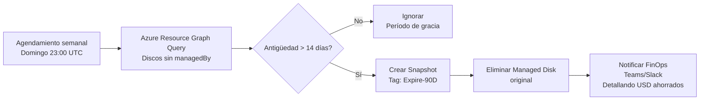

## Índice de Contenidos

1. [La Trampa Silenciosa del Almacenamiento Huérfano](#1-trampa-silenciosa)
2. [Anatomía Financiera: Cuánto Cuesta Realmente](#2-anatomía-financiera)
3. [Detección a Escala Empresarial con Azure Resource Graph](#3-detección-empresarial)
4. [Automatización del Inventario con Azure CLI y PowerShell](#4-automatización-inventario)
5. [El Protocolo Defensivo: Snapshots Preventivos](#5-protocolo-defensivo)
6. [Gobernanza Proactiva con Azure Policy](#6-gobernanza-proactiva)
7. [Pipeline Automatizado de Recorte de Costos](#7-pipeline-automatizado)

---

## 1. La Trampa Silenciosa del Almacenamiento Huérfano en Microsoft Azure

En la gestión diaria de entornos empresariales en Microsoft Azure, los equipos de operaciones e ingeniería crean, escalan y destruyen decenas de máquinas virtuales (Azure Virtual Machines) continuamente. Ya sea para pruebas de integración, despliegues temporales, entornos de pre-producción o migraciones de bases de datos, el ciclo de vida de la infraestructura de cómputo es cada vez más dinámico.

Sin embargo, existe una **trampa arquitectónica y financiera** que suele pasar inadvertida para muchos administradores y líderes de ingeniería: la **desvinculación asimétrica del almacenamiento**.

Cuando un ingeniero o pipeline de CI/CD elimina una máquina virtual mediante Azure Portal, Azure CLI o Terraform sin la configuración explícita de borrado en cascada, Azure elimina la capa de cómputo (CPU y memoria RAM asignadas), pero **los discos administrados (Azure Managed Disks) asociados como disco de sistema operativo (OS Disk) y discos de datos (Data Disks) permanecen intactos en el Resource Group**.

Para la plataforma Azure, estos discos son volúmenes de almacenamiento aprovisionados con:
- Alta disponibilidad
- Redundancia geográfica o local (LRS, ZRS, GRS)
- Rendimiento reservado (IOPS y Throughput)

**Consecuencia:** Microsoft continúa facturando cada gigabyte aprovisionado cada segundo del mes, independientemente de si el disco tiene una máquina virtual encendida leyendo sus bloques o si lleva seis meses completamente desasociado.

En entornos medianos y corporativos sin políticas de gobernanza automatizadas, estos **discos desasociados (discos huérfanos o unattached disks)** pueden representar entre **12% y 35% del gasto mensual total en almacenamiento**, drenando presupuesto operativo sin generar valor de negocio.

**Palabras clave:** discos administrados Azure, discos huérfanos, almacenamiento en reposo, optimización de costos Azure.

---

## 2. Anatomía Financiera: ¿Cuánto Cuesta Realmente un Disco Huérfano?

A diferencia de las máquinas virtuales, donde el costo de cómputo cesa inmediatamente al estado `Deallocated` (detenido), **los discos administrados se cobran por capacidad total aprovisionada, no por espacio consumido**.

Si aprovisionas un disco Premium SSD de 1 TB (P30) y solo grabas 20 GB de datos, pagas mensualmente por los **1024 GB completos**.

### Estructura de Precios Promedio (Regiones Estándar)

| Nivel de Disco | Tamaño Típico / SKU | Capacidad | IOPS Base | Costo Mensual/Disco (USD) | Costo Anual 10 Discos (USD) |
|---|---|---|---|---|---|
| **Standard HDD** | S20 / S30 | 512 GB - 1 TB | 500 | $20 - $40 | $2,400 - $4,800 |
| **Standard SSD** | E20 / E30 | 512 GB - 1 TB | 2,000 | $38 - $75 | $4,560 - $9,000 |
| **Premium SSD (P30)** | P30 | 1,024 GB (1 TB) | 5,000 | $135 - $155 | $16,200 - $18,600 |
| **Premium SSD v2** | Aprovisionado | 1 TB + 6,000 IOPS | 6,000 | $160 - $210 | $19,200 - $25,200 |
| **Ultra Disk** | Aprovisionado | 1 TB + 10,000 IOPS | 10,000 | $300 - $480 | $36,000 - $57,600 |

En una infraestructura típica con 15 desarrolladores y múltiples microservicios, no es inusual encontrar entre 20 y 50 discos no asociados producto de pruebas, snapshots convertidos en discos y VMs migradas. Estamos hablando de una **fuga de capital silenciosa entre $30,000 y $80,000 USD anuales**, atribuible exclusivamente a discos sin operaciones de lectura o escritura.

**Palabras clave:** costos de almacenamiento Azure, Premium SSD, optimización en nuvem, FinOps, cloud cost management.

---

## 3. Detección a Escala Empresarial con Azure Resource Graph (ARG) y KQL

El método tradicional (revisar suscripción por suscripción en el Portal) no es escalable cuando se gestionan decenas de suscripciones bajo una jerarquía de Management Groups.

La herramienta definitiva para auditoría centralizada en milisegundos es **Azure Resource Graph** utilizando **Kusto Query Language (KQL)**, permitiendo interrogar el plano de control de Azure a través de cientos de suscripciones simultáneamente.

### Query 1: Inventario Completo de Discos Huérfanos

```kusto
// Consulta KQL en Azure Resource Graph Explorer
resources
| where type =~ 'microsoft.compute/disks'
| where isnull(managedBy) or managedBy == ""
| project 
    subscriptionId,
    resourceGroup,
    diskName = name,
    skuName = sku.name,
    skuTier = sku.tier,
    diskSizeGB = properties.diskSizeGB,
    timeCreated = properties.timeCreated,
    osType = properties.osType,
    location = location,
    tags = tags
| order by diskSizeGB desc
```

### Query 2: Cálculo Agregado de Almacenamiento Desperdiciado por Suscripción

```kusto
resources
| where type =~ 'microsoft.compute/disks'
| where isnull(managedBy) or managedBy == ""
| summarize 
    UnattachedDisksCount = count(),
    TotalWasteGB = sum(toint(properties.diskSizeGB))
    by subscriptionId, tostring(sku.name)
| order by TotalWasteGB desc
```

**Palabras clave:** Azure Resource Graph, consultas KQL, auditoría de infraestructura, Azure CLI, gobernanza en nube.

---

## 4. Automatización del Inventario con Azure CLI y PowerShell

### Script en Azure CLI: Exportación de Auditoría a JSON/CSV

```bash
#!/usr/bin/env bash
# Script de auditoría para identificar discos no asociados en todas las suscripciones
set -euo pipefail

echo "======================================================================"
echo " Auditoría de Discos Desasociados en Microsoft Azure"
echo "======================================================================"

QUERY="resources | where type =~ 'microsoft.compute/disks' | where isnull(managedBy) or managedBy == '' | project subscriptionId, resourceGroup, name, sku.name, properties.diskSizeGB, properties.timeCreated | order by properties.diskSizeGB desc"

echo "[*] Consultando Azure Resource Graph en todas las suscripciones..."
az graph query -q "$QUERY" --first 1000 --output table

# Exportar a JSON para análisis FinOps
az graph query -q "$QUERY" --first 1000 --output json > ./unattached_disks_report.json
echo "[+] Reporte guardado exitosamente en unattached_disks_report.json"
```

### Script en PowerShell: Clasificación por Antigüedad

Un disco desasociado hace menos de 24h puede formar parte de un proceso de mantenimiento programado. **Sin embargo, un disco huérfano con más de 7 días de inactividad es con 99% de certeza un recurso abandonado:**

```powershell
<#
.SYNOPSIS
    Identifica discos huérfanos con más de 7 días de antigüedad en la suscripción activa.
#>

$SevenDaysAgo = (Get-Date).AddDays(-7)

$UnattachedDisks = Get-AzDisk | Where-Object { 
    $null -eq $_.ManagedBy -and $_.TimeCreated -lt $SevenDaysAgo 
}

Write-Host "Discos huérfanos con más de 7 días encontrados: $($UnattachedDisks.Count)" -ForegroundColor Yellow

$UnattachedDisks | Select-Object Name, ResourceGroupName, Sku, DiskSizeGB, TimeCreated | Format-Table -AutoSize
```

**Palabras clave:** automatización Azure, PowerShell, infraestructura como código, DevOps, CI/CD pipeline.

---

## 5. El Protocolo Defensivo: Snapshotting Preventivo Antes del Borrado

El mayor temor de cualquier equipo de infraestructura al aplicar políticas de recorte de costos es eliminar accidentalmente un disco que contenía datos históricos, auditoría o configuraciones críticas.

Para eliminar el riesgo operacional y asegurar el cumplimiento normativo (ISO 27001, SOC 2, HIPAA), la recomendación es aplicar siempre la regla de **"Snapshot First, Delete Later"**.

### ¿Por qué convertir un disco huérfano en un Snapshot?

1. **Diferencial de Costo Abismal:**
   - Disco Premium SSD (1 TB): ~$140 USD/mes
   - Snapshot (40 GB reales comprimidos): ~$2.00 USD/mes
   - **Ahorro inmediato: 98.5%**

2. **Capacidad de Restauración Rápida:** Un snapshot puede convertirse nuevamente en un Managed Disk en menos de 90 segundos

3. **Inmutabilidad y Cifrado:** El snapshot preserva los metadatos y cifrado original del disco

### Script de Remediación Segura (PowerShell)

```powershell
param (
    [Parameter(Mandatory=$true)]
    [string]$ResourceGroupName,
    [Parameter(Mandatory=$true)]
    [string]$DiskName
)

$Disk = Get-AzDisk -ResourceGroupName $ResourceGroupName -DiskName $DiskName

if ($null -ne $Disk.ManagedBy) {
    Write-Error "El disco $DiskName está actualmente asociado a una máquina virtual. Abortando acción por seguridad."
    exit 1
}

Write-Host "[1/3] Creando Snapshot preventivo de $DiskName..." -ForegroundColor Cyan
$SnapshotConfig = New-AzSnapshotConfig -SourceResourceId $Disk.Id -Location $Disk.Location -CreateOption Copy
$SnapshotName = "$($DiskName)-predelete-snapshot-$(Get-Date -Format 'yyyyMMdd')"
$Snapshot = New-AzSnapshot -ResourceGroupName $ResourceGroupName -SnapshotName $SnapshotName -Snapshot $SnapshotConfig

Write-Host "[2/3] Snapshot creado exitosamente: $($Snapshot.Name)" -ForegroundColor Green

Write-Host "[3/3] Procediendo a la eliminación segura del Managed Disk huérfano..." -ForegroundColor Yellow
Remove-AzDisk -ResourceGroupName $ResourceGroupName -DiskName $DiskName -Force

Write-Host "[+] Remediación completada. El disco ha sido eliminado y respaldado en snapshot de bajo costo." -ForegroundColor Green
```

**Palabras clave:** snapshots Azure, backup en nube, recuperación de desastres, cumplimiento normativo.

---

## 6. Gobernanza Proactiva con Azure Policy

Detectar y borrar discos periódicamente es una solución **reactiva** ("apagar incendios"). La verdadera madurez en nube, según el marco de **FinOps Foundation**, consiste en **evitar que los discos huérfanos existan en primer lugar**.

Podemos aplicar dos mecanismos de gobernanza complementarios:

### 1. Eliminación en Cascada Nativa en la Definición de Máquinas Virtuales

Al crear VMs mediante ARM Templates, Bicep o Terraform, es mandatorio configurar la propiedad `deleteOption: 'Delete'` en el perfil de almacenamiento (`storageProfile`). Esto asegura que cuando la VM sea destruida, Azure limpie automáticamente tanto el OS Disk como los Data Disks asociados:

```bicep
// Fragmento de Bicep para VM con borrado automático de discos
resource vm 'Microsoft.Compute/virtualMachines@2023-09-01' = {
  name: 'vm-app-production'
  location: location
  properties: {
    storageProfile: {
      osDisk: {
        createOption: 'FromImage'
        managedDisk: {
          storageAccountType: 'Premium_LRS'
        }
        deleteOption: 'Delete' // <--- Elimina el OS Disk automáticamente al destruir la VM
      }
      dataDisks: [
        {
          lun: 0
          createOption: 'Empty'
          diskSizeGB: 256
          deleteOption: 'Delete' // <--- Elimina el Data Disk automáticamente
        }
      ]
    }
  }
}
```

### 2. Azure Policy: Etiquetado de Expiración Forzado en Discos No Asociados

Desplegar una directiva personalizada con efecto `AuditIfNotExists` o un Azure Policy remediation task que detecte discos creados sin máquina virtual y aplique una etiqueta obligatoria como `LifecycleStatus: Orphan-Review`.

**Palabras clave:** Azure Policy, infraestructura como código, Bicep, Terraform, gobernanza en nube.

---

## 7. Automatización de un Pipeline Continuo de Recorte de Costos

Para organizaciones con cientos de desarrolladores, el enfoque ideal es orquestar una **Azure Logic App** o un **Azure Automation Runbook** que se ejecute los domingos por la noche:



Este flujo de trabajo elimina la fricción manual, garantiza que ningún dato sensible se destruya sin respaldo y genera un reporte mensual de retorno de inversión (ROI) que justifica el valor de la práctica ante el CFO.

**Palabras clave:** Azure Logic Apps, automatización de procesos, FinOps automation, cloud cost management.

---

## 8. Conclusiones y Próximos Pasos para tu Infraestructura

Optimizar los costos en Microsoft Azure **no significa recortar recursos críticos ni degradar la calidad de tus aplicaciones**. Significa **eliminar el desperdicio invisible**.

Los discos no asociados representan el ejemplo más nítido de cómo pequeños desajustes en la automatización de infraestructura pueden convertirse en facturas innecesarias de **miles de dólares anuales**.

### Plan de Acción Inmediato:

1. **Ejecuta las queries KQL** proporcionadas para auditar tu tenant ahora
2. **Implementa eliminación en cascada** (deleteOption: 'Delete') en todas las nuevas VMs
3. **Configura el protocolo Snapshot First** para discos huérfanos detectados
4. **Automatiza el proceso** con Azure Logic Apps o Automation Runbooks
5. **Monitorea continuamente** con Azure Policy y tags de ciclo de vida

**Palabras clave:** optimización de costos en nubem, FinOps best practices, Azure cost management, cloud architecture.

---

## Palabras Clave Principales (SEO Optimizado)

`Discos Administrados Azure` | `Discos Huérfanos` | `Unattached Disks` | `FinOps Foundation` | `Azure Resource Graph` | `Consultas KQL` | `Azure CLI` | `PowerShell Azure` | `Optimización de Costos Azure` | `Gobernanza en Nube` | `Azure Policy` | `Snapshots Preventivos` | `Azure Cost Management` | `Infraestructura como Código` | `Microsoft Azure` | `Cloud Architecture` | `Optimización de Almacenamiento`

---

## 🚀 ¿Quieres Optimizar tu Infraestructura Azure?

**CSCloudSolutions** es experto en auditorías de costo, implementación de FinOps y automatización de infraestructura en Azure.

Si tu organización:
- ✅ Gestiona múltiples suscripciones de Azure
- ✅ Sospecha tener fugas en almacenamiento, red o cómputo
- ✅ Desea implementar gobernanza cloud automatizada
- ✅ Busca reducir gastos sin comprometer el performance

**📞 Agenda una Sesión de Diagnóstico Gratuita con Nuestros Arquitectos Azure Certificados**

Ofrecemos:
- Auditoría gratuita de 90 minutos de tu tenant Azure
- Reporte detallado de oportunidades de optimización
- Plan de implementación FinOps personalizado
- Soporte continuo en optimización de costos

**🔧** Conoce **CSCloud FinOps** en [finops.cscloudsolutions.com.ar](https://finops.cscloudsolutions.com.ar)

**👉 [Contacto: sales@cscloudsolutions.com.ar](mailto:sales@cscloudsolutions.com.ar) | [Agendar consulta](https://cscloudsolutions.com.ar/#contacto)**

Conecta con nosotros:
- 💼 [@Manuel Chavez](https://linkedin.com/in/manuel-enrique-chavez-manzano/)
- 💼 [CSCloudSolutions](https://www.linkedin.com/company/cscloudsolutions)
- 🌐 [cscloudsolutions.com.ar](https://cscloudsolutions.com.ar)

---

*Publicado por Manuel Chavez | Arquitecto Azure Certificado | CSCloudSolutions*

*Última actualización: 2026-09-11*
